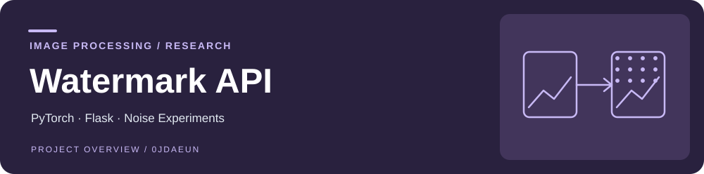
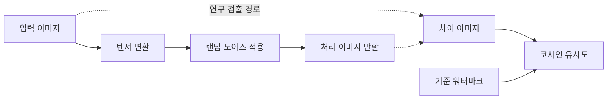

# Watermark API

**이미지 노이즈 적용과 워터마크 검출을 탐색하는 이미지 처리 연구 프로토타입**

Python · Flask · PyTorch · Pillow · TensorFlow (비교 실험)

[연계 모바일 앱 SAFEcam](https://github.com/0JDaEun/SAFEcam)

## 01. 프로젝트 목적

이미지에 미세한 변화를 가하고 그 변화의 검출 가능성을 비교하는 연구용 코드와, 모바일 앱에서 처리 결과를 요청할 수 있는 HTTP API를 구현한다.

## 02. 구현 범위

| 구분 | 파일 | 역할 |
| --- | --- | --- |
| 서비스 API | [app.py](app.py) | 업로드 이미지에 랜덤 노이즈 적용 |
| 연구용 API | [app/main.py](app/main.py) | 파일 기반 워터마크 적용 및 검출 |
| 검출 로직 | [watermark_detection.py](app/utils/watermark_detection.py) | 원본·처리 이미지 차이와 워터마크의 코사인 유사도 비교 |
| 추가 실험 모듈 | [fgsm.py](app/models/fgsm.py), [gan.py](app/models/gan.py) | FGSM 및 GAN 구현 실험 |
| 비교 실험 | [compare_performance.py](compare_performance.py) | 원본과 처리 데이터셋을 이용한 모델 학습 비교 |

FGSM 및 GAN 모듈은 실험 코드이며, 모바일 앱에서 호출하는 기본 처리 API의 실제 실행 알고리즘은 랜덤 노이즈 적용이다.

## 03. 데이터 흐름

## 04. API 개요

- 루트 app.py: GET / 및 GET·POST /apply_watermark. 이미지 업로드는 image 필드를 사용한다.
- 연구용 app/main.py: GET /apply_watermark 및 GET /detect_watermark. 파일 기반 실험 경로다.

두 진입점의 요청·응답 규격은 서로 다르므로 혼용하지 않는다.

## 05. 실행 준비

루트 서비스의 진입점은 python app.py다. 기존 requirements.txt에는 코드에서 사용하는 PyTorch가 명시되어 있지 않으므로 실행 전에 호환되는 의존성을 정리해야 한다. 비교 실험에는 TensorFlow 및 데이터셋 준비도 필요하다.

## 06. 기여 및 검증 범위

[비가시적 워터마킹 API 및 테스트 알고리즘 커밋](https://github.com/0JDaEun/watermark_api/commit/f7a0e9b3c23f62e09fa81042b07813f5a95a5087)을 확인할 수 있다.

현재 소스 구조와 실험 코드 존재를 확인했으나 성능 수치, 데이터셋 라이선스, 공격 방어 효과 및 재압축 강인성은 검증하지 않았다. 향후 동일한 테스트 조건에서 원본·처리 이미지의 품질과 검출 성능을 측정하고 재현 가능한 실험 환경을 구성할 필요가 있다.
